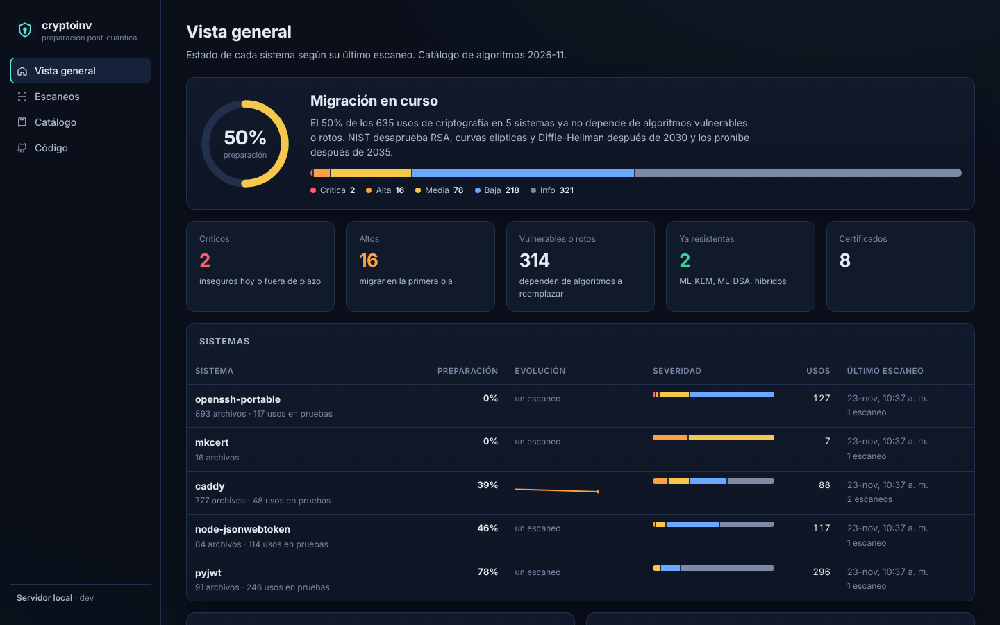
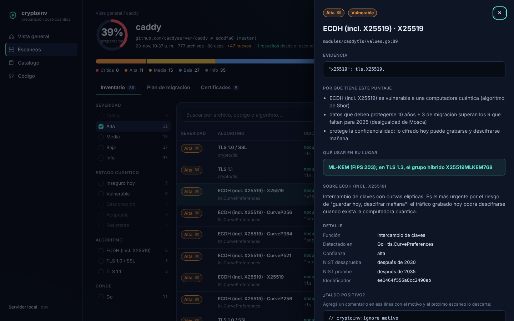
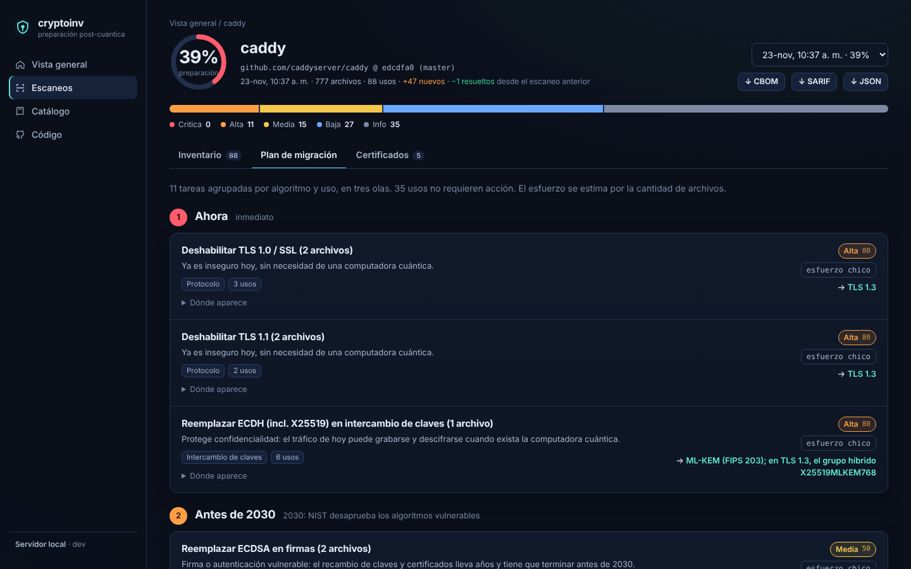

# cryptoinv

**Inventario criptográfico y plan de migración post-cuántica.**
*Cryptographic inventory and post-quantum migration planning: finds every use of cryptography in code, configuration, certificates and keys, scores how urgent it is to migrate, and exports a standard CycloneDX CBOM.*

[](https://github.com/ulisespignatelli/cryptoinv/actions/workflows/ci.yml)
[](https://ulisespignatelli.github.io/cryptoinv/)


---

## El problema

El 27 de octubre de 2026 el NIST publicó la versión final de **IR 8547**, la hoja de ruta para dejar la criptografía que una computadora cuántica puede romper. RSA, ECDSA, EdDSA, ECDH y Diffie-Hellman quedan **desaprobados después de 2030 y prohibidos después de 2035**, con cualquier tamaño de clave. Los reemplazos ya están estandarizados: ML-KEM (FIPS 203), ML-DSA (FIPS 204) y SLH-DSA (FIPS 205).

El primer paso de cualquier migración es saber **dónde está la criptografía**. En una organización grande está repartida en miles de repositorios, configuraciones de servidores, certificados, claves SSH e infraestructura como código, y casi nadie tiene ese inventario. Además, lo que se cifra hoy puede grabarse y descifrarse cuando exista la computadora cuántica (*harvest now, decrypt later*), así que el intercambio de claves es urgente desde ya.

`cryptoinv` arma ese inventario, explica el riesgo de cada uso y lo exporta en los formatos que las plataformas de seguridad ya entienden.



**[Ver la demo →](https://ulisespignatelli.github.io/cryptoinv/)** (escaneos reales de Caddy, OpenSSH, pyjwt, node-jsonwebtoken y mkcert)

## Qué hace

```
$ cryptoinv scan ./mi-servicio
cryptoinv — inventario criptográfico de mi-servicio
42 archivos analizados · 17 usos de criptografía (3 en pruebas) · preparación post-cuántica 24%

  [CRITICA 95] RSA 1024 bits — internal/auth/keys.go:31
    k, err := rsa.GenerateKey(rand.Reader, 1024)
    · RSA es vulnerable a una computadora cuántica (algoritmo de Shor)
    · clave de 1024 bits: por debajo del mínimo aceptable hoy (2048)
    → reemplazo: ML-DSA (FIPS 204) o SLH-DSA (FIPS 205) ...

  [ALTA 80] ECDH (incl. X25519) — deploy/nginx.conf:14
    ssl_ciphers ECDHE-RSA-AES128-GCM-SHA256:...
    · datos que deben protegerse 10 años + 3 de migración superan los 9 que faltan para 2035 (desigualdad de Mosca)
    · protege la confidencialidad: lo cifrado hoy puede grabarse y descifrarse mañana
    → reemplazo: ML-KEM (FIPS 203); en TLS 1.3, el grupo híbrido X25519MLKEM768
```

- **Detecta** criptografía en Go, Python, Java/Kotlin, JavaScript/TypeScript, certificados X.509 y claves (PEM/DER, incluidas ML-KEM, ML-DSA y SLH-DSA), OpenSSH (`sshd_config`, claves públicas), nginx/Apache/HAProxy/OpenSSL, Terraform/Kubernetes/KMS y algoritmos JWT.
- **Evalúa** cada uso con un puntaje de 0 a 100 que siempre explica sus motivos: estado cuántico, fechas del NIST, desigualdad de Mosca (cuánto tienen que durar secretos tus datos y cuánto tarda tu organización en migrar), confidencialidad frente a firma, tamaño de clave y si está en código de prueba.
- **Reconoce lo que ya está bien**: ML-KEM, el intercambio híbrido `X25519MLKEM768` o `mlkem768x25519-sha256` de OpenSSH cuentan como avance en el porcentaje de preparación.
- **Exporta** a CycloneDX 1.6 CBOM, SARIF 2.1.0 (pestaña Security de GitHub), JSON y texto.
- **Arma un plan de migración** en tres olas: *ahora* (lo inseguro hoy y el intercambio de claves expuesto a "grabar hoy, descifrar mañana"), *antes de 2030* (firmas y certificados) y *revisar*. Cada tarea agrupa los usos por algoritmo, con reemplazo, archivos afectados y esfuerzo estimado.
- **Guarda el historial** y muestra la evolución de cada sistema: cuántos usos aparecieron y cuántos se resolvieron desde el escaneo anterior.

## Panel web

```bash
cryptoinv serve ./servicio-a ./servicio-b    # escanea al iniciar y abre el panel en http://127.0.0.1:8080
```

| Inventario con filtros y detalle | Plan de migración |
|---|---|
|  |  |

- **Vista general:** preparación post-cuántica de cada sistema, evolución, severidades y algoritmos más usados.
- **Inventario:** filtros por severidad, estado cuántico, algoritmo y origen (con conteos), búsqueda, exclusión de código de prueba. Los filtros quedan en la URL, así que se pueden compartir. Cada hallazgo explica su puntaje y qué usar en su lugar.
- **Plan de migración**, **certificados** (vencimiento, clave y firma) y **catálogo** de algoritmos con las fechas del NIST.
- Escanear carpetas desde el panel, comparar escaneos y descargar CBOM, SARIF o JSON.

Por seguridad, `serve` escucha solo en `127.0.0.1`. Para exponerlo en una red exige un token (`--token` o `CRYPTOINV_TOKEN`), y `--no-scan` deja el panel en solo lectura. Los escaneos hechos en CI se pueden cargar con `POST /api/v1/scans/import` ([contrato OpenAPI](api/openapi.yaml)).

## Uso

```bash
# Compilar con el panel incluido (requiere Go 1.22+ y Node 20+)
git clone https://github.com/ulisespignatelli/cryptoinv && cd cryptoinv
make build          # bin/cryptoinv

# Solo la herramienta de consola (sin Node)
go install github.com/ulisespignatelli/cryptoinv/backend/cmd/cryptoinv@latest

# Escanear
cryptoinv scan .
cryptoinv scan . --skip-tests                          # sin tests, fixtures ni ejemplos
cryptoinv scan . --format cbom --output cbom.json      # inventario estándar
cryptoinv scan . --format sarif --output results.sarif # para GitHub code scanning
cryptoinv scan . --shelf-life 25 --migration-years 5   # datos de salud, banca, gobierno
cryptoinv scan . --fail-on critica                     # corta el CI si aparece algo crítico
cryptoinv scan . --save                                # lo guarda para verlo en el panel

# Ver el catálogo de algoritmos y fechas
cryptoinv catalog
```

Para descartar un uso que no es criptografía real (por ejemplo, código que solo reconoce el tipo de una clave), agregá un comentario en la misma línea con el motivo:

```go
import "crypto/rsa" // cryptoinv:ignore solo se usa para reconocer el tipo de clave
```

### En GitHub Actions

```yaml
- run: go install github.com/ulisespignatelli/cryptoinv/backend/cmd/cryptoinv@latest
- run: cryptoinv scan . --skip-tests --format sarif --output results.sarif
- uses: github/codeql-action/upload-sarif@v3
  with: { sarif_file: results.sarif, category: cryptoinv }
```

Este mismo repositorio lo hace en su CI ([ci.yml](.github/workflows/ci.yml)).

## Probado en proyectos reales

Escaneos de repositorios públicos (noviembre de 2026):

| Proyecto | Archivos | Usos | En pruebas | Tiempo |
|---|---:|---:|---:|---:|
| FiloSottile/mkcert | 16 | 7 | 0 | 10 ms |
| jpadilla/pyjwt | 91 | 296 | 246 | 28 ms |
| auth0/node-jsonwebtoken | 84 | 117 | 114 | 32 ms |
| caddyserver/caddy | 777 | 88 | 48 | 127 ms |
| pyca/cryptography | 2115 | 1030 | 1025 | 337 ms |

Los CBOM generados validan sin errores contra el esquema oficial de CycloneDX 1.6, y los SARIF contra el de SARIF 2.1.0.

## Arquitectura

Monorepo con arquitectura hexagonal en el backend y un panel organizado por funcionalidades. El contrato OpenAPI es la fuente única entre los dos.

```
api/openapi.yaml            contrato: de acá se generan los tipos del panel
backend/
  cmd/cryptoinv/            CLI (scan, serve, snapshot) · raíz de composición
  internal/
    domain/                 modelo puro: Usage, Finding, Assessment, Scan
    catalog/                algoritmos y fechas NIST como datos (data.json embebido)
    risk/                   evaluación: función pura y explicada
    scan/                   recorrido concurrente de solo lectura
      detectors/            un archivo por lenguaje o formato; las reglas son tablas
    app/                    casos de uso: escanear, vista general, inventario, plan, certificados
    adapters/
      export/               texto, JSON, SARIF, CycloneDX CBOM
      store/                persistencia (archivos JSON atómicos detrás de una interfaz)
      httpapi/              API REST + panel embebido
web/
  src/app/                  rutas y layout
  src/features/             una carpeta por pantalla
  src/shared/               API (real o demo), componentes y lógica pura
docs/adr/                   decisiones de arquitectura
```

| Decisión | Por qué |
|---|---|
| [Monorepo](docs/adr/0001-monorepo.md) | contrato, backend y frontend cambian juntos |
| [Hexagonal](docs/adr/0002-arquitectura-hexagonal.md) | el mismo motor sirve a CLI, API y CI |
| [Catálogo como datos](docs/adr/0003-catalogo-como-datos.md) | las fechas regulatorias cambian; el código no debería |
| [CBOM CycloneDX](docs/adr/0004-cbom-cyclonedx.md) | integrarse con lo que las organizaciones ya usan |
| [Seguridad del escáner](docs/adr/0005-seguridad-del-escaner.md) | correrlo sobre código ajeno sin riesgo |
| [Persistencia](docs/adr/0006-persistencia.md) | historial sin dependencias; Postgres se enchufa después |
| [Panel](docs/adr/0007-frontend.md) | contrato generado, demo con el mismo código, todo en un binario |

El backend usa solo la biblioteca estándar de Go y el panel no tiene dependencias de interfaz: componentes, gráficos e íconos son propios (77 KB comprimido). El escáner nunca ejecuta lo que analiza ni copia material de claves a los informes.

```bash
make test       # Go (con detector de condiciones de carrera) + tipos y tests del panel
make lint       # gofmt + go vet
make serve      # compila todo y levanta el panel escaneando este repositorio
make api-types  # regenera los tipos de TypeScript desde el contrato
```

## Hoja de ruta

- [x] Núcleo: dominio, catálogo NIST, evaluación de riesgo con Mosca
- [x] Escáner con 9 detectores · exportación CBOM, SARIF, JSON y texto · CLI
- [x] API REST con contrato OpenAPI, historial y comparación de escaneos
- [x] Panel web (React + TypeScript) embebido en el binario · demo en GitHub Pages
- [x] Plan de migración priorizado en olas
- [ ] Detectores de C/C++, C#, Rust y PHP
- [ ] Escaneo de endpoints TLS en vivo (qué grupos y certificados ofrece un servidor)
- [ ] Informe ejecutivo en PDF · adaptador de Postgres

## Fuentes

- NIST IR 8547 (octubre de 2026), *Transition to Post-Quantum Cryptography Standards*
- FIPS 203 (ML-KEM), FIPS 204 (ML-DSA), FIPS 205 (SLH-DSA)
- NIST SP 800-131A Rev. 2 · NSA CNSA 2.0
- RFC 8996 (TLS 1.0/1.1 obsoletos) · RFC 7465 (RC4 prohibido en TLS)
- CycloneDX 1.6 (CBOM) · OASIS SARIF 2.1.0

## Licencia

MIT
